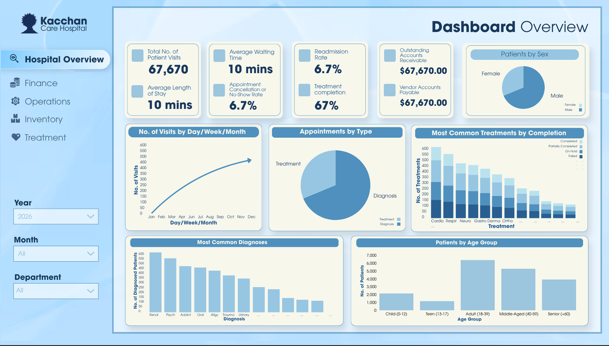

<div align="center">

# Healthcare Industry: Capstone Proposal

Business Intelligence

3DSA2 | Group 6

Members: <br>
Cosme, Marcelo B. <br>
Labnas, Elizabeth C. <br>
San Pedro, Micah Andrea S. <br>
Zantua, Karmen N. <br>


</div>

## **Summary**

This project proposes a business intelligence solution that pairs an interactive BI dashboard with a centralized database to give hospital management a clearer, data-driven view of operations. Hospital performance is currently hard to analyze because data is fragmented and inconsistent, patient records are duplicated or incomplete, and no central repository exists. These problems lead to long appointment wait times, medication shortages and excess inventory, and scheduling conflicts. The dashboard will provide real-time operational visibility, continuous KPI monitoring, better reporting on admissions, discharges, and patient flow, bottleneck identification, financial performance tracking, and historical trend analysis with demand forecasting. A reworked database will support it by centralizing data management, streamlining appointment booking, reducing redundancy, standardizing data formats, and ensuring reliable backup and recovery.

## **Data Source**

The group has chosen the [**Health Care Dataset (20+ Tables)**](https://www.kaggle.com/datasets/moid1234/health-care-data-set-20-tables) from Kaggle as the final dataset for the duration of the capstone. It meets the dataset requirement of having at least 20 interlinked tables while providing a comprehensive relational database for patient, treatment, and hospital management. With over 200+ columns across all tables, the dataset shows promising operational insights for SQL and dashboard creation in healthcare analytics. The dataset includes the following files:

<div style="display: grid; grid-template-columns: 1fr 1fr; gap: 20px;">
  <div>

    1. STG_EHP__DIAG (folder with 2 csv files)
    2. STG_EHP__INVN (folder with 98 csv files)
    3. STG_EHP__PMNT (folder with 3 csv files)
    4. STG_EHP__TMMD (folder with 5 csv files)
    5. STG_EHP__VPMT (folder with 2 csv files)
    6. STG_EHP__ALGY.csv
    7. STG_EHP__APPT.csv
    8. STG_EHP__BILL.csv
    9. STG_EHP__DPMT.csv
    10. STG_EHP__EQPM.csv

  </div>
  <div>

    11. STG_EHP__INSR.csv
    12. STG_EHP__MDBL.csv
    13. STG_EHP__MDCN.csv
    14. STG_EHP__MEDT.csv
    15. STG_EHP__PATN.csv
    16. STG_EHP__PTAL.csv
    17. STG_EHP__ROMS.csv
    18. STG_EHP__SPLY.csv
    19. STG_EHP__STFF.csv
    20. STG_EHP__TRTM.csv
    21. STG_EHP__VIST.csv
    22. STG_EHP__VNDR.csv
    
  </div>
</div>

## **Problem Statement**

## **Metrics (KPIs, threshold)**

## **Website**


## **Sample Dashboard**


## **Solution Architecture**

## **How to Run**

### import data.py

Note: Importing the healthcare dataset files requires approximately 18 GB of available storage space. Ensure sufficient disk space is available before running the import script.

1. **Set healthcare dataset directory**

Open the VSCode terminal and run:

```python
$env:DATA_DIR = "C:\Users\User\replace-data-set-here-location"

python "C:\Users\User\g6-bi-dsa2\src\import data.py"
```

Replace the example dataset with the location of your healthcare dataset folder. The dataset should ideally remain outside the Git repository

2. **Configure import parameters**

In src/import data.py, configure the following parameters before running the script:

```python
    CHECK_ONLY = True                      # change to False to actually load
    CREATE_TABLES = False            # run once, then set back to False
    ONLY = None                            # e.g. ["STG_EHP__ALGY"] to test one table
```
- ``CHECK_ONLY``: Set to True to check dataset files without loading. Set to False to import dataset files
- ``CREATE_TABLES``: Set to True when creating the MySQL tables for the first time. Set back to false afterward
- ``ONLY``: Set to None to process all applicable tables, or specify a specific list of table names

